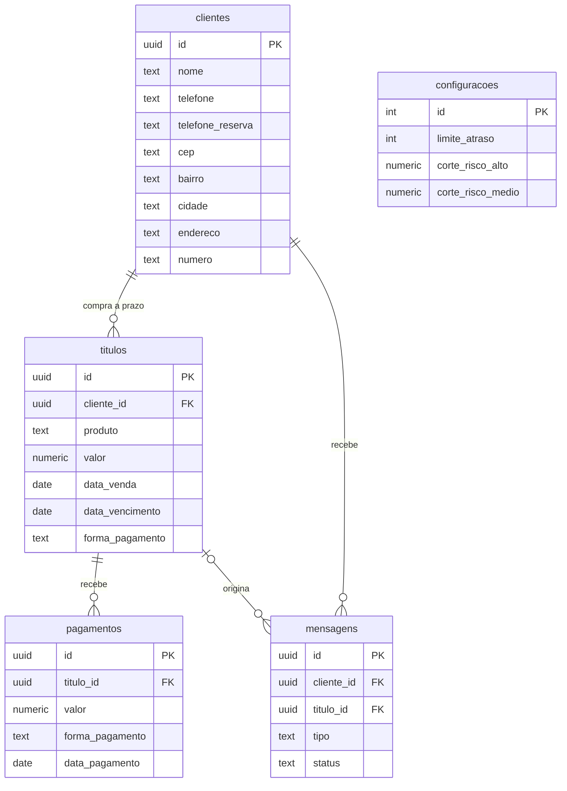

<div align="center">


    

<a href="https://github.com/Kauesouzavr/Central-credito/actions/workflows/ci.yml"></a> <a href="https://github.com/Kauesouzavr/Central-credito/actions/workflows/codeql.yml"></a> <a href="https://github.com/Kauesouzavr/Central-credito/actions/workflows/secret-scan.yml"></a>

<a href="#o-que-já-funciona"><b>Como funciona</b></a> · <a href="#decisões-técnicas-e-por-quê"><b>Decisões técnicas</b></a> · <a href="SECURITY.md"><b>Segurança</b></a> · <a href="#como-rodar-localmente"><b>Rodar localmente</b></a>

</div>

> 🇺🇸 **In English:** a web app to manage store-credit ("pay later") sales for a real small business: customers, receivables, partial payments, a 0–100 default-risk score, a daily collection queue, a risk-adjusted cash-flow forecast and automatic WhatsApp reminders. Next.js (App Router + Server Actions), Supabase (PostgreSQL + RLS + Auth), 98 automated tests.

> Sistema web para controlar **vendas a prazo ("fiado")**: quem deve, quanto, até quando — e quem tem mais risco de não pagar.

**Status:** 🚧 em desenvolvimento — Fases 1 a 9 concluídas, Fase 10 (login) em andamento (ajuste fino dos parâmetros com dados reais fica pra depois do fechamento com o cliente).

---

## O problema

Pequenos negócios que vendem a prazo costumam controlar tudo em caderno ou planilha: fica difícil saber quem está atrasado, quanto falta receber e de quem cobrar primeiro.

Este é um projeto real, desenvolvido sob demanda para um cliente, e vai ser usado no dia a dia por **uma pessoa idosa**. Por isso o critério de design mais importante é **simplicidade**: poucos passos, botões grandes, mensagens claras em português e confirmação antes de qualquer ação que não dá pra desfazer.

## O que já funciona

- Cadastro de cliente **junto com a primeira compra**, num único formulário.
- Lista de clientes e **ficha do cliente** com todos os títulos: valor, pago, restante, vencimento, forma de pagamento e status (em aberto / atrasado / pago).
- **Pagamento parcial**, com validação para não pagar mais do que falta.
- **Marcar título como pago** e **marcar tudo como pago** (todos os títulos em aberto do cliente de uma vez).
- **Nova compra** para cliente já cadastrado: quem quitou tudo continua salvo, com o histórico, sem precisar de novo cadastro.
- **Busca de cliente pelo nome**, na página inicial e na lista: ignora acento e maiúscula ("jose" acha "José"), acha pedaço do nome e não liga pra ordem das palavras. Se ninguém for encontrado, oferece cadastrar como cliente novo. Cliente que já quitou tudo continua na base: é só buscar e usar "+ Nova compra".
- **Risco de inadimplência**: cada cliente recebe uma nota de 0 a 100 e uma etiqueta (baixo / médio / alto) com o motivo em uma frase, na lista e na ficha.
- **Tela "Hoje"** (a própria página inicial): total vencido, quantos clientes precisam de atenção, quantos atrasados nunca foram cobrados, o atraso mais antigo e o total a vencer em 30 dias; o cliente de maior risco em destaque, com o motivo; e a **fila de cobrança do dia**, do risco mais alto ao mais baixo.
- **"Já cobrei"**: um clique (com confirmação) tira o cliente da fila por alguns dias (`dias_repetir_cobranca`); passado o prazo ele volta sozinho. Se clicou por engano, dá pra desfazer.
- **Previsão de caixa** (`/previsao`): quanto deve entrar nas próximas 4 semanas. Compara a **soma dos vencimentos** com a **previsão ajustada pelo risco** de cada cliente, mostra a diferença e um gráfico de barras por período (já vencidos e semanas 1 a 4), com os valores escritos ao lado e uma versão em tabela.
- **Régua de cobrança por WhatsApp**: mensagem de boas-vindas ao cadastrar um cliente novo, aviso alguns dias antes do vencimento, aviso no dia do vencimento e cobrança automática de atraso — tudo mandado sozinho pelo bot, sem precisar apertar nenhum botão. Tela **Cobrança** (`/cobranca`) mostra a régua de cada compra, o feed de mensagens e dá pra pausar/retomar os envios.
- **Ajustes** (`/ajustes`): os números que decidem risco e cobrança (limite de atraso, cortes de risco, dias de aviso/repetição, limites de mensagem por hora/dia), com prévia de quantos clientes ficariam em cada faixa de risco antes de salvar.
- Mensagens de sucesso/erro, confirmação antes de marcar como pago e proteção contra clique duplo.

## Como o risco é calculado

Nota = **atraso atual** (até 60) + **perfil do cliente** (até 20) + **mudança de padrão** (peso configurável, 20 por padrão) + **vários títulos abertos** (15).

| Parte | Regra |
|---|---|
| Atraso atual | Título em aberto mais atrasado: cada dia vale `60 ÷ limite_atraso` pontos, até 60. |
| Perfil | Cliente **novo** (nada quitado ainda): 10 pontos. Cliente **antigo**: até 20, conforme a proporção dos títulos quitados que foram pagos com atraso (sempre em dia = 0). |
| Mudança de padrão | Soma o peso se o cliente já quitou 3+ títulos, todos em dia, e agora atrasou. |
| Vários títulos abertos | +15 se o cliente tem mais de um título em aberto ao mesmo tempo (valor fixo, não é por título). |

Alto a partir de 55 pontos, médio a partir de 25 (cortes em `configuracoes`). Com os valores iniciais e um título aberto, um cliente novo vira médio com 4 dias de atraso e alto com 12; um antigo que sempre pagou em dia, com 7 e 14. Com dois títulos abertos, o cliente novo já começa no médio (10 + 15 = 25), mesmo sem atraso. A fórmula é uma função pura em [`lib/risco.js`](lib/risco.js), coberta por testes (`npm test`), e os parâmetros ficam no banco para serem ajustados com dados reais (Fase 9).

## Como a previsão de caixa é calculada

Para cada cliente: **previsão = saldo em aberto × chance de pagar**, com chance = `max(0,15; 1 − nota de risco ÷ 130)`. Cliente sem risco tem 100% de chance; com a nota máxima (100), cerca de 23%. Os títulos são separados por período: **já vencidos** (ainda podem ser recebidos), **semana 1** (hoje a hoje+6), **semanas 2, 3 e 4**. O que vence depois de 4 semanas fica de fora da conta e aparece só como um aviso. A diferença entre a soma dos vencimentos e a previsão é o que a nota de risco indica que pode não entrar. A conta é uma função pura em [`lib/previsao.js`](lib/previsao.js), em centavos, com testes: cada valor previsto é arredondado uma vez só, então gráfico, tabela e totais fecham no centavo.

## Decisões técnicas (e por quê)

| Decisão | Motivo |
|---|---|
| **Login com Supabase Auth, conferido em duas camadas** (`proxy.js` + `exigirLogin()` em cada Server Action) | O proxy manda quem não está logado para `/login`, mas Server Actions são endpoints que podem ser chamados direto; por isso cada uma confere a sessão de novo (`getUser()`, que valida no servidor de autenticação, não só o cookie) antes de usar a chave `service_role`, que nunca chega ao navegador. |
| **RLS ligado em todas as tabelas, sem nenhuma política** | Bloqueia totalmente a chave pública (`anon`) caso ela seja usada por engano no navegador. |
| **Pagamentos em tabela própria** (uma linha por pagamento), não um campo acumulado | Dá histórico, permite forma de pagamento diferente por parcela e corrigir um lançamento sem bagunçar o total. |
| **Saldo calculado numa view SQL** (`titulos_com_saldo`) | Fonte única da verdade: `valor_pago`, `valor_restante`, `dias_atraso` e `status` nunca são recalculados à mão nas telas. |
| **Dinheiro em centavos inteiros no código** e `numeric(12,2)` no banco | Evita erros de ponto flutuante ao comparar e somar valores. |
| **"Hoje" no fuso de Brasília** (`America/Sao_Paulo`), na view e no app | O banco roda em UTC: sem isso, a partir das 21h um título que vence hoje aparecia como atrasado. Bug real, encontrado e corrigido. |
| **Ações idempotentes** | "Marcar como pago" relê o saldo no servidor na hora do clique; um clique duplo não paga duas vezes. |
| **Server Actions em vez de API routes** | Menos código e menos superfície: cada formulário chama direto a função do servidor. |
| **Motor de risco como função pura, testada, com parâmetros no banco** | Regra de negócio fácil de testar e de ajustar sem mexer em código. O histórico é lido página por página: o Supabase limita 1000 linhas por consulta, e ler só a primeira daria nota errada sem avisar. |
| **Tela "Hoje" também como função pura** (`lib/hoje.js`), separada da leitura do banco | Contagens, ordem da fila e prazos são testados sem precisar de banco nem de navegador. |
| **"Já cobrei" grava na tabela `mensagens`** (a mesma que a régua de WhatsApp vai usar) | A fila e o contador de "nunca cobrados" já funcionam agora, e a Fase 6 entra sem migração: as mensagens automáticas passam a contar como cobrança do mesmo jeito. |
| **WhatsApp via Baileys** (biblioteca não-oficial, conexão por QR code), não a Cloud API oficial da Meta | Fase de demonstração pra fechar negócio: a Cloud API exige verificação de empresa e aprovação de template antes de mandar qualquer mensagem, o que atrasa mostrar o sistema funcionando. Baileys manda texto livre na hora. Em troca, roda como processo à parte (`scripts/whatsapp-bot.mjs`), não dá pra hospedar na Vercel (serverless), e tem risco (baixo, com o volume daqui) de bloqueio por não ser API oficial — mitigado com limite de mensagens por hora/dia e atraso aleatório entre envios. Reavaliar se/quando for pra produção de verdade. |

## Modelo de dados



Além das tabelas, a view `titulos_com_saldo` entrega cada título já com saldo, dias de atraso e status. O schema completo está em [`supabase/schema.sql`](supabase/schema.sql).

## Stack

- **Next.js** (App Router) com **React 19**, em JavaScript puro
- **Supabase** (PostgreSQL) via `@supabase/supabase-js`
- Tailwind CSS + framer-motion, lucide-react, sonner, recharts (redesign visual da Fase 8 — ver [`DESIGN.md`](DESIGN.md))

## Roadmap

| Fase | Entrega | Status |
|---|---|---|
| 1 | Schema no Supabase + projeto Next.js rodando | ✅ |
| 2a | Cadastro de cliente + primeira compra, lista de clientes, ficha | ✅ |
| 2b | Pagamento parcial, marcar como pago, nova compra, "marcar tudo como pago" | ✅ |
| 3 | **Motor de risco**: nota de 0 a 100 por cliente (atraso atual, perfil de cliente novo × antigo, mudança de padrão), com parâmetros configuráveis | ✅ |
| 4 | **Tela "Hoje"**: números do dia, cliente de maior risco em destaque e fila de cobrança (com "Já cobrei") | ✅ |
| 5 | **Previsão de caixa**: soma dos vencimentos × previsão ajustada pelo risco, em 4 semanas, com gráfico | ✅ |
| 6 | **Régua de cobrança via WhatsApp** (Baileys): decide quem avisar/cobrar (`lib/regua.js`), monta o texto (`lib/mensagens-whatsapp.js`) e manda pelo bot (`scripts/whatsapp-bot.mjs`), com limite de mensagens e atraso aleatório entre envios | ✅ |
| 7 | **Relatório semanal** (`/relatorio`): vendido, recebido, clientes novos, títulos que atrasaram e mensagens de WhatsApp mandadas, últimos 7 dias comparados com os 7 anteriores | ✅ |
| 8 | **Redesign visual**: painel vermelho/marca, cartões "glass", Manrope, animações — port de um protótipo do MagicPatterns, incluindo as telas novas **Cobrança** (`/cobranca`, pausar/retomar a régua) e **Ajustes** (`/ajustes`, números de risco e cobrança com prévia ao vivo) (ver [`DESIGN.md`](DESIGN.md)) | ✅ |
| 9 | Testes finais (revisão de código, correções e teste de uso real) e parâmetros padrão em uso. Ajuste fino com dados reais fica pra depois do fechamento com o cliente | ✅ |
| 10 | **Login e segurança**: Supabase Auth, portão no `proxy.js`, sessão conferida em cada Server Action, cabeçalhos de segurança, CodeQL, Dependabot e varredura de segredos no CI (ver [`SECURITY.md`](SECURITY.md)). Próximo passo: separar os dados por empresa (multi-tenant) | 🚧 |

## Como rodar localmente

Pré-requisitos: Node.js 20+ e um projeto no [Supabase](https://supabase.com) (o plano gratuito basta).

1. `npm install`
2. No painel do Supabase, abra o **SQL Editor** e rode todo o conteúdo de [`supabase/schema.sql`](supabase/schema.sql).
   *(Se você já tinha criado o banco antes da correção de fuso horário, rode também [`supabase/correcao-fuso.sql`](supabase/correcao-fuso.sql).)*
3. Copie `.env.local.example` para `.env.local` e preencha (Supabase → Project Settings → API):
   - `SUPABASE_URL` → Project URL
   - `SUPABASE_SERVICE_ROLE_KEY` → chave **service_role**
   - `SUPABASE_ANON_KEY` → chave **anon** (usada só no servidor, para o login)
   - Rode também [`supabase/multi-tenant-auth.sql`](supabase/multi-tenant-auth.sql) e crie um usuário em **Authentication → Users**.
4. `npm run dev` e abra <http://localhost:3000>

Testes automáticos (motor de risco, busca, tela "Hoje" e previsão de caixa): `npm test`.

**Dados fictícios para testar:** `npm run seed:teste` cria 10 clientes de mentira, cada um numa situação diferente do motor de risco (cliente novo, antigo que já quitou tudo, atrasado, com pagamento parcial...). Eles são marcados com a cidade `TESTE` e telefones inválidos (`(00) 00000-00XX`), e `npm run seed:teste:remover` apaga só eles, sem tocar nos clientes reais. Os comandos leem o `.env.local`.

**Régua de WhatsApp (Fase 6):** `npm run whatsapp:bot` inicia o bot (Baileys). Na primeira vez, escaneie o QR code que aparece no terminal (WhatsApp no celular → Aparelhos conectados → Conectar um aparelho); a sessão fica salva em `whatsapp-auth/` (não versionada) e reconecta sozinha depois disso. É um processo que fica rodando — não um comando de um clique só — e não dá pra hospedar na Vercel junto com o resto do app (ver "Decisões técnicas"). Bancos criados antes da Fase 6 precisam rodar também [`supabase/fase6-whatsapp.sql`](supabase/fase6-whatsapp.sql).

A tabela `mensagens` funciona como fila: qualquer parte do app pode gravar uma linha com `status: 'pendente'` (hoje, só o cadastro de cliente novo faz isso, em [`app/clientes/novo/actions.js`](app/clientes/novo/actions.js)) e o bot manda pra frente a cada ciclo — não precisa saber quem gravou. Os outros três tipos (antes do vencimento, vencimento, atraso) são decididos pela própria régua (`lib/regua.js`), a cada ciclo.

**Ligar o bot sozinho, e mantê-lo rodando sem precisar olhar pra ele** (opcional, configurar uma vez por computador): depois de já ter escaneado o QR code pelo menos uma vez, registre uma tarefa no Agendador de Tarefas do Windows apontando pra [`scripts/iniciar-bot.bat`](scripts/iniciar-bot.bat). Dois gatilhos juntos: "Ao fazer logon" (liga quando o computador é ligado/alguém entra) e um que repete a cada 5 minutos pra sempre — como a tarefa já é configurada pra **ignorar um novo disparo se já tiver uma instância rodando**, na prática isso funciona como um vigia: se o bot cair (ou for fechado sem querer), o próprio Windows liga ele de novo em até 5 minutos, sem precisar de nenhum script extra nem de ninguém notar. Pelo PowerShell:

```powershell
$acao = New-ScheduledTaskAction -Execute "CAMINHO\ATE\O\PROJETO\scripts\iniciar-bot.bat" -WorkingDirectory "CAMINHO\ATE\O\PROJETO"
$gatilhoLogon = New-ScheduledTaskTrigger -AtLogOn -User "$env:USERDOMAIN\$env:USERNAME"
$gatilhoRepeticao = New-ScheduledTaskTrigger -Once -At (Get-Date) -RepetitionInterval (New-TimeSpan -Minutes 5) -RepetitionDuration (New-TimeSpan -Days 3650)
$config = New-ScheduledTaskSettingsSet -RestartCount 999 -RestartInterval (New-TimeSpan -Minutes 1) -ExecutionTimeLimit ([TimeSpan]::Zero) -StartWhenAvailable -MultipleInstances IgnoreNew
$principal = New-ScheduledTaskPrincipal -UserId "$env:USERDOMAIN\$env:USERNAME" -LogonType Interactive -RunLevel Limited
Register-ScheduledTask -TaskName "CentralCredito-WhatsAppBot" -Action $acao -Trigger @($gatilhoLogon, $gatilhoRepeticao) -Settings $config -Principal $principal -Description "Bot de WhatsApp do Central de Credito"
```

Troque `CAMINHO\ATE\O\PROJETO` pelo caminho real nesse computador. **Nunca rode o bot manualmente enquanto a tarefa agendada já estiver de pé** — duas instâncias ao mesmo tempo competem pela mesma sessão do WhatsApp (`whatsapp-auth/`), o que arrisca corromper a sessão ou desconectar o número. Pra ver se já tem uma rodando: `Get-ScheduledTask -TaskName CentralCredito-WhatsAppBot` (no PowerShell) mostra o estado.

O bot também se vigia por dentro: se ficar **20 minutos sem completar um ciclo** (`whatsapp-bot.heartbeat`, atualizado a cada volta do loop principal, não é versionado), ele mesmo se encerra — é assim que um travamento "vivo, mas sem fazer nada" (já aconteceu na prática, sem o processo cair sozinho) também acaba sendo corrigido pelo gatilho de repetição acima, em vez de ficar parado até alguém notar.

## Estrutura do projeto

```
app/
  page.js                     Início = tela "Hoje" (números do dia, fila de cobrança)
  actions.js                  Server Actions: "Já cobrei" e desfazer
  layout.js                   Layout raiz: TopNav, Toaster, comentário de decisão de design
  globals.css                 Tailwind + classes custom do design (glass, botões, brilho)
  previsao/page.js            Previsão de caixa (cartões, gráfico recharts e tabela)
  relatorio/page.js           Relatório semanal narrativo (copiar/exportar)
  cobranca/                   Régua de cada compra, feed de mensagens, pausar/retomar
  ajustes/                    Números de risco/cobrança, com prévia ao vivo
  api/exportar-csv/route.js   Exporta clientes + títulos em CSV
  clientes/
    page.js                   Lista de clientes (busca/filtro no cliente) + modal "Novo cliente"
    novo/actions.js           Server Action de cadastro (chamada pelo modal)
    [id]/
      page.js                 Ficha do cliente
      actions.js              Server Actions: pagamento, marcar como pago, editar dados
      nova-compra/actions.js  Server Action de nova compra (chamada pelo modal na ficha)
  componentes/
    TopNav.jsx                 Menu fixo com indicador de aba ativa animado
    BotaoAcao.js                Botão com confirmação e trava contra clique duplo
    ui/                         Button, GlassPanel, Modal, TextField, NumberStepper, RiskRing/Badge, Avatar, Toaster...
    hoje/, clientes/, ficha/, previsao/, regua/, ajustes/, relatorio/, forms/
                                 Componentes de cada tela, portados do design de referência
lib/
  supabase-server.js          Cliente Supabase (somente servidor)
  util.js                     Moeda, datas, centavos, "hoje" no fuso de Brasília
  risco.js / risco.test.js    Motor de risco (função pura) + testes
  hoje.js / hoje.test.js      Tela "Hoje": contagens, fila e destaque (função pura) + testes
  previsao.js / previsao.test.js  Previsão de caixa (função pura) + testes
  regua.js / regua.test.js    Decide quem recebe aviso/cobrança hoje (função pura) + testes
  mensagens-whatsapp.js / .test.js  Monta o texto de cada mensagem + testes
  limite-envio.js / .test.js  Limite de mensagens por hora/dia e atraso aleatório + testes
  relatorio.js / .test.js     Números da semana vs. a anterior (função pura) + testes
  carregar-*.js                Cada um busca no Supabase e monta o resumo da tela correspondente
  relatorio-texto.js           Narrativa do relatório semanal, a partir do que carregar-relatorio.js/hoje.js/previsao.js já calculam
  csv.js                       Monta o CSV de clientes + títulos (usado pelo Route Handler)
  risco-ui.js / titulo-ui.js / mensagem-ui.js  Cores e rótulos em português por nível de risco/status — um lugar só
  buttonStyles.js               Classes Tailwind dos botões (primary/secondary/ghost)
scripts/
  seed-teste.mjs              Cria/remove os clientes fictícios de teste
  whatsapp-bot.mjs            Bot de WhatsApp (Baileys): conecta e roda a régua em loop
supabase/
  schema.sql                  Schema completo (tabelas, view, RLS)
  correcao-fuso.sql           Correção de fuso para bancos já existentes
  fase6-whatsapp.sql          Colunas de configuração da régua, para bancos já existentes
  adicionar-pausa-whatsapp.sql  Coluna do botão "Pausar envios", para bancos já existentes
```

## Autor

Desenvolvido por **Kauê Souza** · [LinkedIn](https://www.linkedin.com/in/kauesouzaproti/) · [GitHub](https://github.com/Kauesouzavr)
